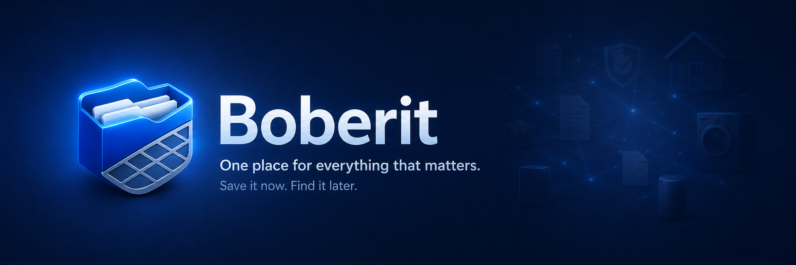
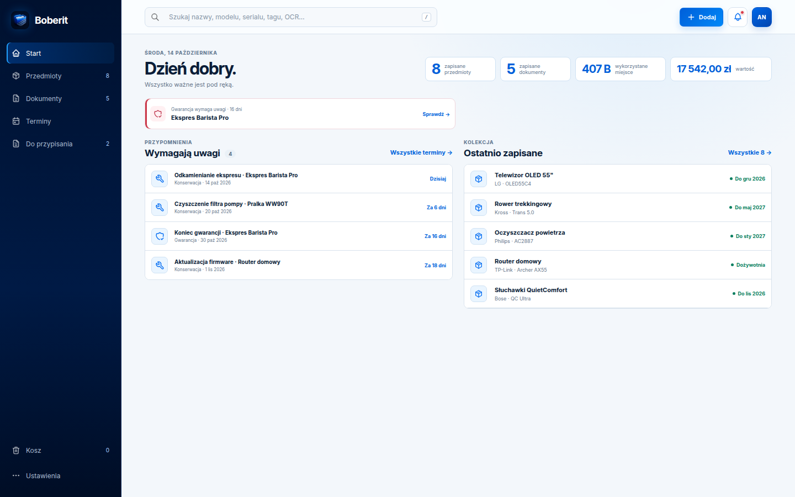
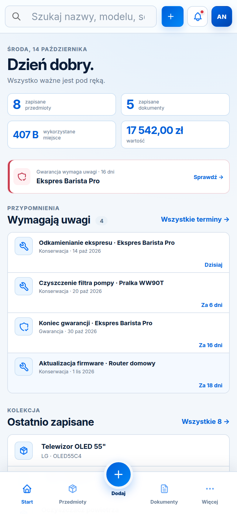

# Boberit

**One place for everything that matters.**  
**Save it now. Find it later.**



Boberit is a self-hosted home archive for items and documents. It keeps purchase data, warranties, maintenance, attachments, standalone documents, and local OCR in one compact interface that works on phones and desktops.

## Features

- **Items** with purchase data, warranty, tags, notes, and attachments.
- **Deadlines** for warranties and one-off or recurring maintenance, with a history of completed tasks.
- **Documents** and a **To assign** inbox for bulk imports that you sort into items or documents later.
- **Local OCR** (Polish and English) for images and PDFs, with one search across items, documents, tags, and recognized text.
- **Accounts and households** with owner and member roles, isolated data, and a 30-day trash.
- **Backup and restore** of a household, activity history, and configurable webhooks.
- **Installable PWA** with quick capture of photos, files, items, and documents.

The interface is currently available in Polish; English is planned.

## Preview

<p align="center">
  
  
</p>

## Quick start

Requirements: Docker with Compose.

1. Create `compose.yaml`:

   ```yaml
   services:
     boberit:
       image: ghcr.io/pbuzdygan/boberit:latest
       container_name: boberit
       user: "${PUID:-1000}:${PGID:-1000}"
       ports:
         - "${APP_PORT:-3219}:3000"
       environment:
         APP_ENC_KEY: ${APP_ENC_KEY:?Set APP_ENC_KEY, ex. openssl rand -hex 32}
         TZ: ${TZ:-UTC}
       volumes:
         - boberit-data:/data
       # Hardening: no Linux capabilities or privilege escalation are needed. Raise the limits
       # if large OCR jobs or backup restores run out of memory.
       cap_drop:
         - ALL
       security_opt:
         - no-new-privileges:true
       mem_limit: 2g
       cpus: 2
       pids_limit: 256
       restart: unless-stopped

   volumes:
     boberit-data:
   ```

2. Generate the required encryption key next to it:

   ```bash
   printf 'APP_ENC_KEY=%s\n' "$(openssl rand -hex 32)" > .env
   ```

   The key protects webhook secrets stored in the database and is **not** included in backups. Keep a secure copy of `.env` and do not change the key for an existing installation: losing it makes stored webhook secrets unrecoverable.

3. Start Boberit:

   ```bash
   docker compose up -d
   ```

Open `http://localhost:3219`. On first start you create the owner account and the first household. The form asks for a one-time setup code, which Boberit prints to its log:

```bash
docker compose logs boberit | grep "Kod pierwszej konfiguracji"
```

Data is stored in the `boberit-data` volume and survives `docker compose down`. **Never use `docker compose down -v`** if you want to keep your data.

### Updating

Download a backup in **Settings → Backup** first, then:

```bash
docker compose pull
docker compose up -d
```

The `latest` tag follows stable releases; `dev_latest` follows development prereleases. Each release is also tagged with its version (`X.Y.Z` or `devX.Y.Z`).

## Documentation

- [Configuration and data](docs/CONFIGURATION.md) — environment variables, data layout, bind mounts, uploads, OCR, and backups.
- [Product blueprint](docs/PRODUCT_BLUEPRINT.md) — product principles, target scope, and roadmap.
- [Color system](docs/COLOR_SYSTEM.md) — UI palette and its CSS tokens.
- [Changelog](CHANGELOG.md) — changes in each release.
